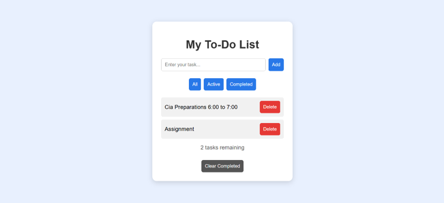

# Ex03 To-Do List using JavaScript
## Date: 16.11.2026

## AIM
To create a To-do Application with all features using JavaScript.

## ALGORITHM
### STEP 1
Build the HTML structure (index.html).

### STEP 2
Style the App (style.css).

### STEP 3
Plan the features the To-Do App should have.

### STEP 4
Create a To-do application using Javascript.

### STEP 5
Add functionalities.

### STEP 6
Test the App.

### STEP 7
Open the HTML file in a browser to check layout and functionality.

### STEP 8
Fix styling issues and refine content placement.

### STEP 9
Deploy the website.

### STEP 10
Upload to GitHub Pages for free hosting.

## PROGRAM

```html

<!DOCTYPE html>
<html lang="en">
<head>
    <meta charset="UTF-8">
    <meta name="viewport" content="width=device-width, initial-scale=1.0">
    <title>To-Do Application</title>
    <link rel="stylesheet" href="style.css">
</head>
<body>

    <div class="container">
        <h1>My To-Do List</h1>

        <div class="input-area">
            <input type="text" id="taskInput"
                   placeholder="Enter your task...">
            <button onclick="addTask()">Add</button>
        </div>

        <div class="filters">
            <button onclick="filterTasks('all')">All</button>
            <button onclick="filterTasks('active')">Active</button>
            <button onclick="filterTasks('completed')">Completed</button>
        </div>

        <ul id="taskList"></ul>

        <p id="taskCount">0 tasks remaining</p>

        <button class="clear-btn" onclick="clearCompleted()">
            Clear Completed
        </button>
    </div>

    <script src="script.js"></script>
</body>
</html>

```

```css

body {
    font-family: Arial, sans-serif;
    background: #e8f0fe;
    display: flex;
    justify-content: center;
    align-items: center;
    min-height: 100vh;
    margin: 0;
}

.container {
    background: white;
    width: 350px;
    padding: 25px;
    border-radius: 12px;
    box-shadow: 0 4px 15px rgba(0,0,0,0.15);
    text-align: center;
}

h1 {
    color: #333;
}

.input-area {
    display: flex;
    gap: 8px;
}

input {
    flex: 1;
    padding: 10px;
    border: 1px solid #ccc;
    border-radius: 5px;
}

button {
    padding: 10px;
    border: none;
    border-radius: 5px;
    background: #2878e8;
    color: white;
    cursor: pointer;
}

button:hover {
    background: #155bb5;
}

.filters {
    margin: 20px 0;
    display: flex;
    justify-content: center;
    gap: 8px;
}

ul {
    padding: 0;
    list-style: none;
}

li {
    display: flex;
    justify-content: space-between;
    align-items: center;
    background: #f1f1f1;
    padding: 10px;
    margin-bottom: 8px;
    border-radius: 5px;
}

li.completed span {
    text-decoration: line-through;
    color: gray;
}

.delete-btn {
    background: #e53935;
}

.clear-btn {
    background: #555;
    margin-top: 10px;
}

#taskCount {
    color: #555;
}

```

```js

let tasks = JSON.parse(localStorage.getItem("tasks")) || [];
let currentFilter = "all";

function saveTasks() {
    localStorage.setItem("tasks", JSON.stringify(tasks));
}

function addTask() {
    let input = document.getElementById("taskInput");
    let taskText = input.value.trim();

    if (taskText === "") {
        alert("Please enter a task!");
        return;
    }

    tasks.push({
        id: Date.now(),
        text: taskText,
        completed: false
    });

    input.value = "";
    saveTasks();
    displayTasks();
}

function displayTasks() {
    let taskList = document.getElementById("taskList");
    taskList.innerHTML = "";

    let filteredTasks = tasks.filter(task => {
        if (currentFilter === "active")
            return !task.completed;

        if (currentFilter === "completed")
            return task.completed;

        return true;
    });

    filteredTasks.forEach(task => {
        let li = document.createElement("li");

        if (task.completed) {
            li.classList.add("completed");
        }

        let span = document.createElement("span");
        span.textContent = task.text;
        span.style.cursor = "pointer";

        span.onclick = () => toggleTask(task.id);

        let deleteButton = document.createElement("button");
        deleteButton.textContent = "Delete";
        deleteButton.className = "delete-btn";

        deleteButton.onclick = () => deleteTask(task.id);

        li.appendChild(span);
        li.appendChild(deleteButton);

        taskList.appendChild(li);
    });

    let remaining = tasks.filter(task => !task.completed).length;

    document.getElementById("taskCount").textContent =
        remaining + " tasks remaining";
}

function toggleTask(id) {
    tasks = tasks.map(task => {
        if (task.id === id) {
            task.completed = !task.completed;
        }
        return task;
    });

    saveTasks();
    displayTasks();
}

function deleteTask(id) {
    tasks = tasks.filter(task => task.id !== id);

    saveTasks();
    displayTasks();
}

function filterTasks(filter) {
    currentFilter = filter;
    displayTasks();
}

function clearCompleted() {
    tasks = tasks.filter(task => !task.completed);

    saveTasks();
    displayTasks();
}

document.getElementById("taskInput").addEventListener("keypress", function(event) {
    if (event.key === "Enter") {
        addTask();
    }
});

displayTasks();

```
## OUTPUT



## RESULT
The program for creating To-do list using JavaScript is executed successfully.